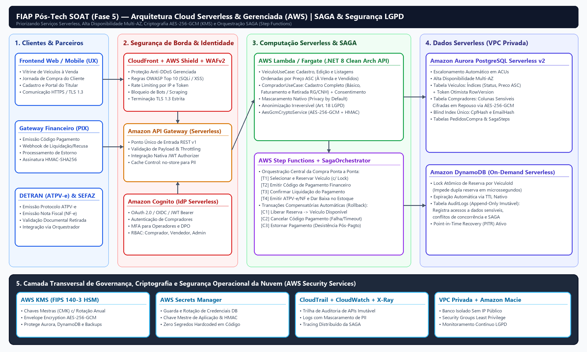

# FIAP Pós-Tech SOAT (Fase 5) — Plataforma de Revenda de Veículos Automotores

[](https://dotnet.microsoft.com/)
[](#2-arquitetura-do-código-clean-architecture--ddd)
[](#3-processo-de-compra-ponta-a-ponta-saga-orquestrada)
[](#4-segurança-de-dados-sensíveis-e-conformidade-lgpd)

Plataforma backend e API RESTful desenvolvida para a **Fase 5 do Tech Challenge (Software Architecture - SOAT)** da **FIAP Pós-Tech**. A solução implementa integralmente o ecossistema de uma **Revenda de Veículos Automotores**, contemplando gestão de estoque, listagens ordenadas por preço, cadastro seguro de compradores sob a **LGPD (Lei nº 13.709/2018)** e o processo completo de compra do início ao fim coordenado via **SAGA Orquestrada** (com controle de concorrência e transações compensatórias automáticas).

---

## 1. Documentação Técnica e Entregáveis Exigidos (Pasta `docs/`)

Todos os relatórios exigidos pelo enunciado do Tech Challenge Fase 5 encontram-se na pasta **[`docs/`](./docs/)** (fora da raiz do código-fonte `src/`), incluindo o **PDF consolidado** pronto para submissão:

- 📄 **[PDF Completo Consolidado (`docs/Relatorio-Tecnico-Fase5-SOAT.pdf`)](./docs/Relatorio-Tecnico-Fase5-SOAT.pdf)**
- ☁️ **[1. Desenho da Arquitetura Cloud Serverless & Gerenciada + Justificativas (`docs/01-Arquitetura-Cloud-Serverless.md`)](./docs/01-Arquitetura-Cloud-Serverless.md)**
- 🔐 **[2. Relatório de Segurança de Dados Sensíveis, Políticas e Matriz de Riscos LGPD (`docs/02-Relatorio-Seguranca-Dados-LGPD.md`)](./docs/02-Relatorio-Seguranca-Dados-LGPD.md)**
- 🔄 **[3. Relatório de Orquestração SAGA e Transações Compensatórias (`docs/03-Relatorio-Orquestracao-SAGA.md`)](./docs/03-Relatorio-Orquestracao-SAGA.md)**
- 🖼️ **[Diagramas de Arquitetura, SAGA e Segurança (`docs/diagramas/`)](./docs/diagramas/)**



---

## 2. Arquitetura do Código (Clean Architecture & DDD)

O código-fonte está organizado na pasta `src/` seguindo estritamente os princípios de **Clean Code**, **SOLID**, **Domain-Driven Design (DDD)** e **Clean Architecture**:

```text
fiap-fase5/
├── src/                                       # Raiz do código-fonte da aplicação
│   ├── RevendaVeiculos.Domain/                # Camada de Domínio (Entidades, Value Objects, Enums, Interfaces, Exceções)
│   ├── RevendaVeiculos.Application/           # Camada de Aplicação (Use Cases, Orquestrador SAGA, DTOs, Portas)
│   ├── RevendaVeiculos.Infrastructure/        # Camada de Infraestrutura (EF Core, AES-256-GCM, HMAC-SHA256, Repositórios, Worker)
│   └── RevendaVeiculos.Api/                   # Camada de Apresentação REST (Controllers, Middlewares RFC 7807/OWASP, JWT, Swagger)
├── tests/                                     # Suíte de Testes Automatizados (36 testes aprovados)
│   ├── RevendaVeiculos.UnitTests/             # Testes de Unidade (Domínio, Value Objects, Criptografia AES-256, SAGA)
│   └── RevendaVeiculos.IntegrationTests/      # Testes de Integração End-to-End (API, Concorrência, Falha Pagamento, Desistência)
├── docs/                                      # Pasta fora da raiz do código com os relatórios e PDF exigidos
│   ├── 01-Arquitetura-Cloud-Serverless.md
│   ├── 02-Relatorio-Seguranca-Dados-LGPD.md
│   ├── 03-Relatorio-Orquestracao-SAGA.md
│   ├── diagramas/
│   └── Relatorio-Tecnico-Fase5-SOAT.pdf
├── infra/                                     # Infraestrutura como Código (IaC)
│   ├── terraform/main.tf                      # Provisionamento AWS Serverless (API GW, Step Functions, Aurora v2, KMS, WAF)
│   └── k8s/deployment.yaml                    # Manifestos Kubernetes
├── Dockerfile                                 # Build multi-stage .NET 8
├── docker-compose.yml                         # Orquestração local (API + PostgreSQL 16)
├── collection.json                            # Coleção Postman / Insomnia
└── RevendaVeiculos.sln                        # Solution .NET 8
```

---

## 3. Processo de Compra Ponta a Ponta (SAGA Orquestrada)

A classe `CompraVeiculoSagaOrchestrator` implementa o padrão **SAGA Orquestrada**, garantindo consistência eventual e reversão segura em todos os cenários do processo de compra:

### ✅ Fluxo Esperado (Happy Path):
1. **Seleção e Reserva do Veículo (`POST /api/v1/compras/reservar`):**
   - Valida que o comprador está cadastrado, ativo e com consentimento LGPD;
   - Aplica lock de concorrência por veículo e altera o status para `Reservado` (com expiração automática configurada);
   - Emite o **Código de Pagamento** (`PAY-PIX-...`) junto ao serviço financeiro e retorna ao cliente.
2. **Pagamento pelo Cliente (`POST /api/v1/compras/{pedidoId}/pagamento` com `pagamentoEfetuado: true`):**
   - Confirma a liquidação financeira do código de pagamento e avança a SAGA para `PagamentoConfirmado`.
3. **Retirada do Veículo e Baixa no Estoque (`POST /api/v1/compras/{pedidoId}/retirada`):**
   - Valida a documentação obrigatória do comprador para retirada (`RG` e `CNH` vigente);
   - Emite o protocolo de transferência **`ATPV-e` (DETRAN)** e a **Nota Fiscal Eletrônica (`NF-e`)**;
   - Efetua a **baixa definitiva do veículo no estoque** (`Status = Vendido`) e conclui a SAGA (`ConcluidoBaixaEstoque`).

### ⚠️ Fluxos de Exceção e Transações Compensatórias (Rollbacks SAGA):
- **Problema 1 — Outro(a) cliente reserva o veículo antes (Concorrência):**
  - Bloqueado instantaneamente via semáforo transacional por `VeiculoId` + token otimista `RowVersion`, retornando `409 Conflict` (`ConflitoConcorrenciaException`) e gravando auditoria.
- **Problema 2 — Pagamento não é efetuado ou expira:**
  - Ao receber `pagamentoEfetuado: false` (ou por timeout no `ReservaExpiracaoBackgroundService`), o Orquestrador SAGA executa as transações compensatórias: **invalida o código de pagamento** e **libera o veículo de volta para `Disponivel` no estoque**.
- **Problema 3 — O(a) cliente desiste da compra em qualquer um dos passos (`POST /api/v1/compras/{pedidoId}/desistir`):**
  - Se o cliente desistir **antes de pagar**: cancela o código de pagamento, cancela a reserva e devolve o veículo para `Disponivel`.
  - Se o cliente desistir **após já ter pago** (antes da retirada): o Orquestrador SAGA executa automaticamente o **Estorno Financeiro (`EstornarPagamentoAsync`)**, altera o status financeiro para `Estornado` e devolve o veículo para `Disponivel` no estoque.

---

## 4. Segurança de Dados Sensíveis e Conformidade LGPD

- **Criptografia Autenticada em Repouso (`AES-256-GCM`):** Os dados sensíveis do comprador (`CPF`, `RG`, `CNH`, `Endereço`, `Telefone` e `E-mail`) são cifrados coluna a coluna na aplicação (`AesGcmCryptoService`) com Nonce aleatório de 96 bits e Tag de integridade de 128 bits antes de serem persistidos no banco de dados.
- **Indexação Cega (`HMAC-SHA256`):** Unicidade de CPF e E-mail validada através de hashes determinísticos (`CpfHash` e `EmailHash`), impedindo exposição de texto claro em índices do banco.
- **Privacy by Default (Mascaramento Nativo):** Listagens e consultas padrão ocultam automaticamente dados sensíveis (`***.456.789-**`, `ga***@cliente.com.br`).
- **Acesso Completo Auditado & Direito ao Esquecimento:** A descriptografia para emissão de documentação exige justificativa e gera log imutável em `AuditLog`; titulares podem solicitar anonimização irreversível (`POST /api/v1/compradores/{id}/anonimizar`).

---

## 5. Resumo dos Endpoints da API REST

| Método | Endpoint | Descrição |
| :---: | :--- | :--- |
| `POST` | `/api/v1/veiculos` | Cadastrar um veículo para venda (Marca, modelo, ano, cor, preço, placa, chassi, renavam, etc.) |
| `PUT` | `/api/v1/veiculos/{id}` | Editar os dados de um veículo disponível |
| `GET` | `/api/v1/veiculos/a-venda` | **Listar veículos à venda, ordenados por preço do mais barato para o mais caro** |
| `GET` | `/api/v1/veiculos/vendidos` | **Listar veículos vendidos, ordenados por preço do mais barato para o mais caro** |
| `GET` | `/api/v1/veiculos/{id}` | Consultar veículo por ID |
| `POST` | `/api/v1/compradores` | Cadastrar comprador (dados básicos + dados de pagamento + dados de retirada RG/CNH + LGPD) |
| `PUT` | `/api/v1/compradores/{id}` | Atualizar dados cadastrais do comprador |
| `GET` | `/api/v1/compradores` | Listar compradores (com dados sensíveis mascarados por padrão) |
| `GET` | `/api/v1/compradores/{id}/dados-completos` | Acesso restrito e auditado aos dados descriptografados para documentação/faturamento |
| `POST` | `/api/v1/compradores/{id}/anonimizar` | Anonimizar dados sensíveis do titular (Direito ao Esquecimento - Art. 18 LGPD) |
| `POST` | `/api/v1/compras/reservar` | **Passo 1 e 2 SAGA:** Selecionar veículo, reservar no estoque e emitir código de pagamento |
| `POST` | `/api/v1/compras/{pedidoId}/pagamento` | **Passo 3 SAGA:** Confirmar pagamento ou acionar compensação por falha de pagamento |
| `POST` | `/api/v1/compras/{pedidoId}/retirada` | **Passo 4 SAGA:** Emitir documentação (`ATPV-e` + `NF-e`), retirar veículo e dar baixa no estoque |
| `POST` | `/api/v1/compras/{pedidoId}/desistir` | **Compensação SAGA:** Desistência em qualquer passo (com estorno se pago e liberação do estoque) |
| `POST` | `/api/v1/compras/efetuar-venda` | Executar venda completa orquestrada de ponta a ponta |
| `GET` | `/api/v1/compras/{pedidoId}` | Consultar estado da SAGA e histórico detalhado de passos (`PassosSaga`) |
| `POST` | `/api/v1/seguranca/token` | Emitir token JWT Bearer para testes de papéis (RBAC) |
| `GET` | `/api/v1/seguranca/auditoria` | Consultar trilha imutável de auditoria (`AuditLog`) |
| `GET` | `/api/v1/seguranca/politicas-lgpd` | Consultar manifesto técnico das regras de segurança e proteção de dados |

---

## 6. Como Executar o Projeto e os Testes

### Opção 1: Execução Direta com .NET 8 SDK (Banco In-Memory pré-populado com Seed)
```bash
dotnet run --project src/RevendaVeiculos.Api/RevendaVeiculos.Api.csproj
```
Acesse o **Swagger UI** em: `http://localhost:5000/swagger` (ou na porta exibida no terminal).

### Opção 2: Execução Containerizada com Docker Compose (API + PostgreSQL 16)
```bash
docker-compose up -d --build
```
Acesse o **Swagger UI** em: `http://localhost:8080/swagger`

### Executando a Suíte Completa de Testes Automatizados (Unitários + Integração SAGA/LGPD)
```bash
dotnet test RevendaVeiculos.sln --verbosity normal
```
