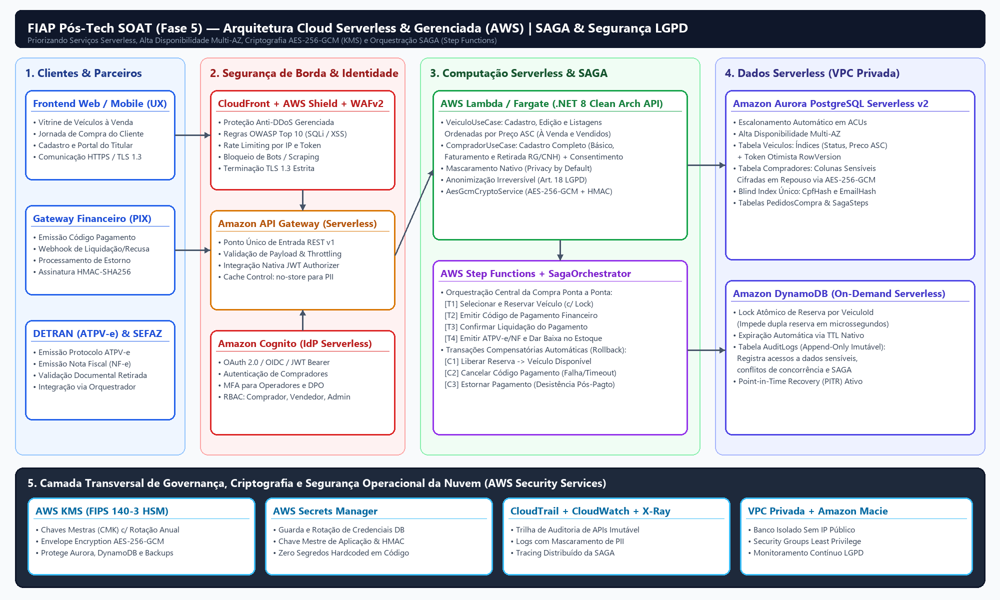
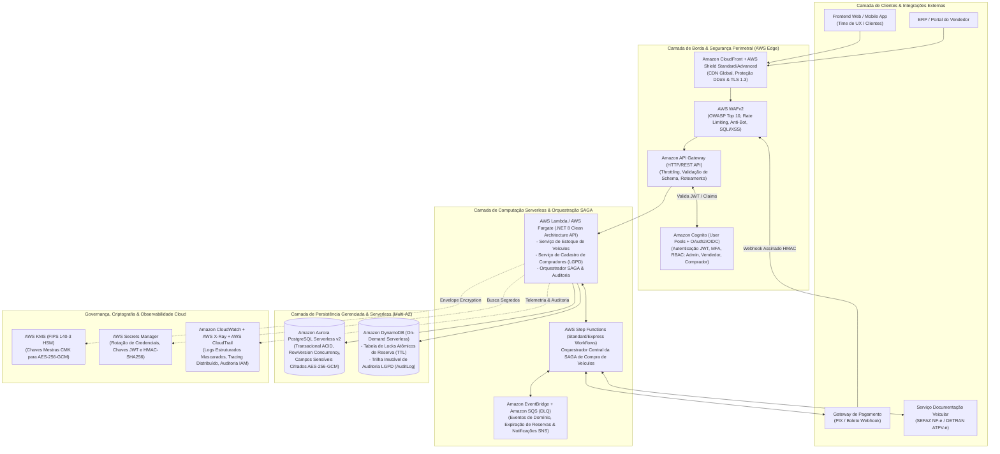

# 1. Desenho da Arquitetura Cloud Serverless e Gerenciada (AWS)

**Projeto:** Plataforma de Revenda de Veículos Automotores — FIAP Pós-Tech SOAT (Fase 5)  
**Repositório Oficial:** [https://github.com/GabrielNascZz/fiap-fase5](https://github.com/GabrielNascZz/fiap-fase5)

---

## 1.1. Visão Geral da Arquitetura Cloud-Native

A arquitetura da plataforma de revenda de veículos automotores foi projetada seguindo os princípios do **AWS Well-Architected Framework** (Excelência Operacional, Segurança, Confiabilidade, Eficiência de Performance e Otimização de Custos), **Clean Architecture**, **Domain-Driven Design (DDD)** e **Serverless-First**.

O objetivo central do desenho arquitetural é garantir:
1. **Escalabilidade elástica sob demanda (Zero Provisionamento Ocioso):** absorver picos de acesso na vitrine de veículos à venda e disputas simultâneas de reserva sem degradação de latência.
2. **Consistência transacional distribuída via SAGA Orquestrada:** coordenar reserva de estoque, faturamento/código de pagamento, confirmação financeira, emissão de documentação veicular (ATPV-e / Nota Fiscal) e baixa no estoque — com transações compensatórias determinísticas para concorrência, falha de pagamento ou desistência do cliente.
3. **Proteção rigorosa de Dados Pessoais e Sensíveis (Conformidade LGPD - Lei nº 13.709/2018):** isolamento de rede, criptografia autenticada em repouso (`AES-256-GCM` integrada ao AWS KMS), indexação cega via `HMAC-SHA256`, mascaramento por padrão (*Privacy by Default*) e trilha de auditoria imutável.

---

## 1.2. Diagrama da Arquitetura (Mermaid)

---

## 1.3. Justificativa da Escolha dos Serviços Serverless e Gerenciáveis

A tabela abaixo detalha cada serviço gerenciado/serverless escolhido na arquitetura e a justificativa técnica e de negócio para sua adoção:

| Camada | Serviço Cloud (AWS) | Tipo | Justificativa Técnica e de Negócio |
| :--- | :--- | :--- | :--- |
| **API & Roteamento** | **Amazon API Gateway** | Serverless | Ponto único de entrada (*Single Point of Entry*) para o frontend criado pelo time de UX e para webhooks de pagamento. Gerencia *throttling*, validação de payload, versionamento (`/api/v1`), *canary releases* e integração nativa com Cognito e WAF sem necessidade de manter servidores de proxy reverso. |
| **Computação da API** | **AWS Lambda (.NET 8 Native AOT / Container) & AWS Fargate** | Serverless | Executa os casos de uso da aplicação (.NET 8 Clean Architecture) com escalonamento automático de zero a milhares de requisições concorrentes. Elimina administração de sistema operacional, aplica *patches* automaticamente e cobra exclusivamente pelo tempo de computação consumido (ms). |
| **Orquestração SAGA** | **AWS Step Functions** | Serverless | Coordena de forma visual, resiliente e auditável a máquina de estados da **SAGA Orquestrada** de compra do veículo (`Reserva -> Código de Pagamento -> Pagamento -> Documentação/Retirada -> Baixa no Estoque`), gerenciando nativamente *timeouts* de reserva (ex.: 30 min via `waitForTaskToken`), *retries* exponenciais e execução determinística dos passos de **compensação (rollback)** em caso de falha de pagamento ou desistência do comprador. |
| **Banco de Dados Relacional** | **Amazon Aurora PostgreSQL Serverless v2** | Serverless / Gerenciado | Combina a robustez transacional ACID do PostgreSQL (essencial para ordenação indexada por preço `ORDER BY Preco ASC`, integridade referencial e controle de concorrência otimista via `RowVersion`) com escalonamento instantâneo em frações de ACU (*Aurora Capacity Units*), *failover* Multi-AZ automático e backups contínuos no Amazon S3. |
| **Controle de Concorrência & Auditoria** | **Amazon DynamoDB (On-Demand)** | Serverless | Utilizado para: (1) *Distributed Lock* atômico por `VeiculoId` com expiração automática via `TTL`, impedindo que dois clientes reservem o mesmo veículo simultaneamente em microssegundos; e (2) armazenamento de alta vazão da trilha de auditoria LGPD (`AuditLog`). |
| **Mensageria & Eventos** | **Amazon EventBridge + Amazon SQS + SNS** | Serverless | Desacopla notificações assíncronas ao comprador (envio do código de pagamento PIX/Boleto, confirmação de emissão do ATPV-e/NF-e) e garante reprocessamento seguro com *Dead-Letter Queues (DLQ)* caso serviços externos (DETRAN/SEFAZ) apresentem instabilidade temporária. |

---

## 1.4. Serviços de Segurança da Nuvem Utilizados e Justificativa

Como a plataforma manipula dados pessoais sensíveis do comprador (CPF, RG, CNH, Data de Nascimento, Endereço residencial/cobrança e histórico financeiro), foram incorporados serviços gerenciados de segurança em profundidade (*Defense in Depth*):

1. **AWS Key Management Service (AWS KMS - FIPS 140-3):**
   - **Uso:** Gerenciamento de chaves criptográficas mestras (*Customer Managed Keys - CMK*) com rotação anual automática.
   - **Justificativa:** Fornece a raiz de confiança em hardware (*HSM*) para a criptografia em repouso do Aurora Serverless v2, do DynamoDB e do serviço de criptografia de aplicação (`AesGcmCryptoService` — `AES-256-GCM`) que cifra coluna a coluna os dados sensíveis de compradores (`CPF`, `RG`, `CNH`, `Endereço`, `Telefone` e `E-mail`).

2. **AWS Secrets Manager:**
   - **Uso:** Armazenamento seguro e rotação automática de credenciais de banco de dados, chave mestra de criptografia de aplicação, chave de assinatura `HMAC-SHA256` (utilizada para indexação cega de `CpfHash` e `EmailHash`) e segredos de validação de webhooks do gateway de pagamento.
   - **Justificativa:** Elimina completamente credenciais ou chaves *hardcoded* em código-fonte ou variáveis de ambiente expostas, atendendo às exigências de segurança operacional da LGPD e ISO 27001.

3. **Amazon Cognito (User Pools & Identity Pools):**
   - **Uso:** Provedor de identidade gerenciado (IdP) compatível com OAuth 2.0 / OpenID Connect (OIDC), emitindo tokens `JWT` assinados com suporte a MFA (*Multi-Factor Authentication*).
   - **Justificativa:** Garante que **somente compradores cadastrados e autenticados** possam iniciar a reserva e compra de veículos, além de segregar papéis (*RBAC*: `Comprador`, `Vendedor`, `Admin`, `DPO-EncarregadoDados` e `GatewayPagamento`).

4. **AWS WAFv2 (Web Application Firewall) + AWS Shield:**
   - **Uso:** Inspeciona todo o tráfego HTTP/HTTPS na borda antes de atingir o API Gateway.
   - **Justificativa:** Bloqueia ataques do **OWASP Top 10** (SQL Injection, Cross-Site Scripting - XSS, Command Injection), aplica *Rate Limiting* por IP/Token (mitigando ataques de força bruta, *scraping* de estoque ou negação de serviço na reserva de veículos) e garante disponibilidade contra ataques DDoS.

5. **AWS CloudTrail + Amazon CloudWatch Logs + Amazon Macie:**
   - **Uso:** Rastreamento imutável de chamadas de API na conta AWS (CloudTrail), logs operacionais com mascaramento automático de PII (CloudWatch Data Protection) e descoberta/monitoramento de dados sensíveis (Macie).
   - **Justificativa:** Assegura rastreabilidade ponta a ponta para auditorias de conformidade LGPD (Art. 37 e Art. 46 da Lei 13.709/2018), permitindo comprovar quem acessou cada dado sensível, quando e com qual finalidade jurídica.

6. **AWS VPC (Sub-redes Privadas Isoladas + VPC Endpoints + Security Groups):**
   - **Uso:** Isolamento de rede do banco de dados Amazon Aurora Serverless v2 em sub-redes privadas sem rota para a Internet (*No Public IP*).
   - **Justificativa:** Garante que os dados dos compradores e do estoque jamais fiquem expostos diretamente à internet pública, restringindo o tráfego exclusivamente à camada de aplicação na porta `5432` via Security Groups com privilégio mínimo (*Least Privilege*).
