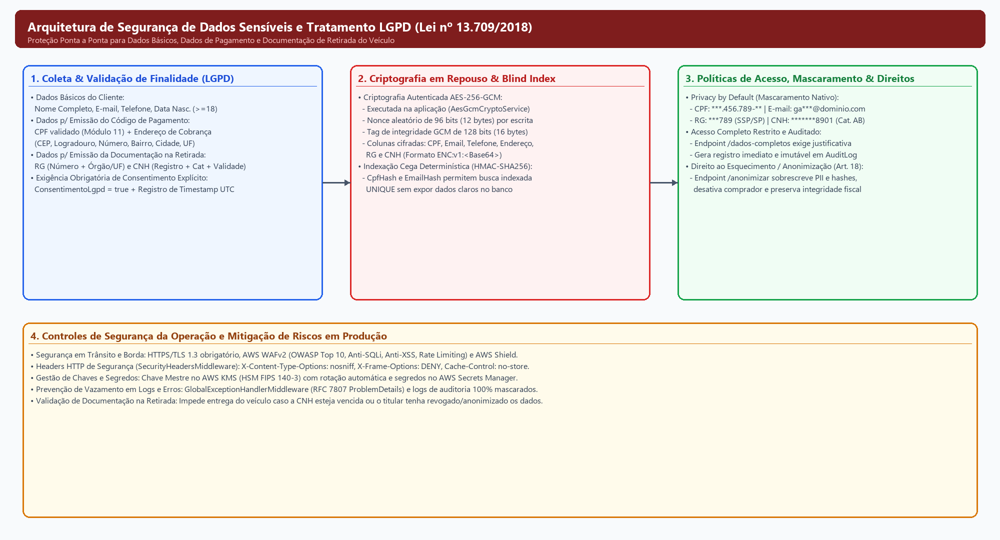

# 2. Relatório de Segurança de Dados e Conformidade LGPD

**Projeto:** Plataforma de Revenda de Veículos Automotores — FIAP Pós-Tech SOAT (Fase 5)  
**Base Legal:** Lei Geral de Proteção de Dados Pessoais (LGPD — Lei nº 13.709/2018), Marco Civil da Internet (Lei nº 12.965/2014) e ISO/IEC 27001 / 27701.

---

## 2.1. Inventário de Dados Armazenados pela Solução

A plataforma armazena quatro domínios de dados estritamente necessários ao funcionamento do negócio (*Princípio da Necessidade / Minimização de Dados — Art. 6º, III da LGPD*):

| Entidade / Domínio | Campos Armazenados | Finalidade de Negócio | Retenção e Ciclo de Vida |
| :--- | :--- | :--- | :--- |
| **1. Estoque de Veículos (`Veiculo`)** | `Id`, `Marca`, `Modelo`, `AnoFabricacao`, `AnoModelo`, `Cor`, `Preco`, `Placa`, `Chassi (VIN)`, `Renavam`, `Quilometragem`, `Combustivel`, `Cambio`, `Descricao`, `Status (Disponivel, Reservado, Vendido)`, `RowVersion`, `DataVenda` | Exibição na vitrine ordenada por preço, controle de concorrência de reserva e emissão de documentação de transferência (ATPV-e / NF-e). | Permanente para histórico patrimonial e fiscal da revenda. |
| **2. Cadastro de Clientes (`Comprador`)** | `Id`, `NomeCompleto`, `Email`, `EmailHash`, `Telefone`, `DataNascimento`, `Cpf`, `CpfHash`, `Endereco (CEP, Logradouro, Número, Complemento, Bairro, Cidade, UF)`, `Rg (Número, Órgão Emissor, UF)`, `Cnh (Número Registro, Categoria, Validade)`, `ConsentimentoLgpd`, `DataConsentimentoLgpd`, `FinalidadeTratamento`, `Anonimizado`, `Ativo` | Identificação do comprador, emissão do código de pagamento/faturamento e emissão da documentação legal de transferência e retirada do veículo. | Ativo durante o relacionamento; sujeito à anonimização sob solicitação do titular (Art. 18 LGPD) ressalvadas obrigações fiscais (5 anos - CTN Art. 173). |
| **3. Transação e SAGA (`PedidoCompra` & `SagaStepLog`)** | `Id`, `VeiculoId`, `CompradorId`, `ValorVenda`, `StatusPedido`, `StatusPagamento`, `CodigoReserva`, `DataExpiracaoReserva`, `CodigoPagamento`, `ProtocoloDocumentacaoRetirada`, `NotaFiscalNumero`, `MotivoCancelamento`, `PassosSaga` | Coordenação ponta a ponta da compra, rastreabilidade financeira, controle de timeout de reserva e execução de compensações SAGA. | 5 anos para conformidade contábil, fiscal e prevenção a fraudes. |
| **4. Trilha de Auditoria (`AuditLog`)** | `Id`, `UsuarioResponsavel`, `Acao`, `Entidade`, `EntidadeId`, `DetalhesSeguranca (Mascarados)`, `OrigemIp`, `CriadoEm` | Rastreabilidade de segurança da informação, investigação de incidentes e comprovação de conformidade perante a ANPD. | Imutável (*Append-Only*) por no mínimo 5 anos. |

---

## 2.2. Classificação de Dados Pessoais e Dados Sensíveis (PII / LGPD)

Para cumprir os requisitos de emissão do código de pagamento e de emissão da documentação de retirada do veículo sem expor o(a) titular a riscos em caso de incidente, todos os atributos do cliente foram classificados segundo seu grau de criticidade:

| Atributo do Cliente | Classificação | Finalidade Específica no Processo de Compra | Mecanismo Técnico de Proteção no Banco e na API |
| :--- | :--- | :--- | :--- |
| **CPF** | **Crítico (PII de Alta Sensibilidade)** | Obrigatório para emissão do código de pagamento (PIX/Boleto registrado no Banco Central), Nota Fiscal Eletrônica (NF-e) e ATPV-e junto ao DETRAN. | Cifrado em repouso via **AES-256-GCM** (`ENC:v1:...`). Busca de unicidade via **Blind Index (`HMAC-SHA256` em `CpfHash`)**. Mascarado por padrão na API (`***.456.789-**`). |
| **RG (Número + Órgão Emissor)** | **Crítico (PII Documental)** | Obrigatório para lavratura da Autorização para Transferência de Propriedade do Veículo (ATPV-e / CRV) no momento da retirada. | Cifrado em repouso via **AES-256-GCM**. Mascarado por padrão (`***789 (SSP/SP)`). |
| **CNH (Registro + Categoria + Validade)** | **Crítico (PII Documental)** | Obrigatório para validação de habilitação vigente e identificação civil na retirada física do automóvel da loja. | Cifrado em repouso via **AES-256-GCM**. Mascarado por padrão (`*******8901 (Cat. AB)`). |
| **Endereço Completo** | **Confidencial (PII de Localização)** | Obrigatório para faturamento do código de pagamento, emissão de NF-e e registro de domicílio do proprietário no DETRAN. | Serializado e cifrado integralmente via **AES-256-GCM**. Mascarado em listagens (`*** - Bela Vista, São Paulo/SP - CEP 01310-***`). |
| **E-mail e Telefone** | **Confidencial (PII de Contato)** | Envio do código de pagamento, notificações de reserva e comprovante de retirada. | Cifrados em repouso via **AES-256-GCM**; `EmailHash` com `HMAC-SHA256`; mascarados (`ga***@dominio.com`, `(**) *****-4321`). |
| **Nome Completo & Data de Nascimento** | **Pessoal Identificável (PII)** | Identificação contratual e verificação de maioridade civil ($\ge 18$ anos). | Validação de domínio na entrada e anonimização irreversível (`TITULAR ANONIMIZADO LGPD #...`) no exercício do Direito ao Esquecimento. |

---

## 2.3. Políticas de Acesso a Dados Implementadas

1. **Criptografia Autenticada em Nível de Coluna (*Application-Level Field Encryption — AES-256-GCM*):**
   - Implementada na classe `AesGcmCryptoService` e integrada de forma transparente ao `RevendaDbContext` via `ValueConverter` do Entity Framework Core.
   - Cada campo sensível (`Cpf`, `Email`, `Telefone`, `Endereco`, `Rg`, `Cnh`) recebe um **Nonce criptográfico aleatório de 96 bits (12 bytes)** exclusivo a cada gravação e uma **Tag de Autenticação de 128 bits (16 bytes)**, garantindo confidencialidade semântica (*IND-CPA*) e integridade contra adulteração (*IND-CCA2*). Mesmo um administrador de banco de dados (*DBA*) executando `SELECT * FROM Compradores` visualiza apenas payloads cifrados (`ENC:v1:...`).

2. **Indexação Cega Determinística (*Blind Indexing — HMAC-SHA256*):**
   - Como a criptografia `AES-256-GCM` gera textos cifrados distintos para o mesmo CPF (graças ao Nonce aleatório), a verificação de duplicidade e busca exata utiliza os campos `CpfHash` e `EmailHash`, calculados com `HMAC-SHA256` usando uma chave secreta segregada no AWS Secrets Manager. Isso permite índices `UNIQUE` de alta performance sem armazenar o CPF ou e-mail em texto claro.

3. **Mascaramento de Dados por Padrão (*Privacy by Default — Art. 46, § 2º da LGPD*):**
   - Todos os endpoints padrão de consulta e listagem (`GET /api/v1/compradores`, `GET /api/v1/compradores/{id}`, `GET /api/v1/compras`) retornam exclusivamente o DTO `CompradorMascaradoResponse`, ocultando dígitos centrais/iniciais de documentos e endereços.

4. **Controle de Acesso Baseado em Papéis (*RBAC*) e Acesso Auditado (*Just-in-Time Purpose Binding*):**
   - O acesso aos dados completos descriptografados (`GET /api/v1/compradores/{id}/dados-completos`) é segregado da listagem comum, exigindo identificação do operador e justificativa explícita (`motivoAcesso`), gerando imediatamente um registro imutável na tabela `AuditLogs` (`ACESSO_DADOS_SENSIVEIS_COMPLETOS`).

5. **Direito ao Esquecimento e Anonimização Irreversível (Art. 18, IV e VI da LGPD):**
   - O endpoint `POST /api/v1/compradores/{id}/anonimizar` sobrescreve de forma irreversível os atributos pessoais e hashes do comprador, desativa o cadastro para novas compras e preserva apenas os vínculos contábeis anonimizados exigidos pela legislação tributária.

---

## 2.4. Políticas de Segurança da Operação Implementadas

1. **Segurança em Trânsito (TLS 1.3 & HSTS):**
   - Toda comunicação entre clientes, API Gateway, microsserviços/Lambdas e bancos de dados ocorre obrigatoriamente sobre **HTTPS / TLS 1.3**.
2. **Headers de Segurança HTTP (OWASP Secure Headers):**
   - O `SecurityHeadersMiddleware` injeta em todas as respostas:
     - `X-Content-Type-Options: nosniff`
     - `X-Frame-Options: DENY`
     - `X-XSS-Protection: 1; mode=block`
     - `Referrer-Policy: no-referrer`
     - `Permissions-Policy: geolocation=(), microphone=(), camera=()`
     - `Cache-Control: no-store, no-cache, must-revalidate` (impede que proxies ou navegadores armazenem em cache dados sensíveis de compradores ou códigos de pagamento).
3. **Autenticação JWT Bearer (OAuth 2.0 / OIDC) e Validação de Assinatura:**
   - Autenticação via tokens JWT assinados com `HMAC-SHA256` / `RS256` (Amazon Cognito / `SegurancaAuditoriaController`), validando emissor (`Issuer`), audiência (`Audience`), tempo de expiração (`Lifetime`) e chave criptográfica.
4. **Sanitização de Erros e Prevenção de Vazamento de Stack Trace (RFC 7807 ProblemDetails):**
   - O `GlobalExceptionHandlerMiddleware` intercepta qualquer falha inesperada e retorna uma estrutura padronizada `application/problem+json` com `traceId`, jamais expondo detalhes internos de infraestrutura, queries SQL ou dados pessoais em logs de erro.
5. **Logs de Auditoria Imutáveis e Mascarados:**
   - Todos os registros gravados em `AuditLog` utilizam valores previamente mascarados (`cpf.Mascarado()`, `email.Mascarado()`), garantindo que mesmo os sistemas de observabilidade (CloudWatch / SIEM) não se tornem vetores de exposição de PII.

---

## 2.5. Matriz de Riscos e Ações de Mitigação para Possíveis Falhas

| ID | Risco / Falha Potencial Identificada | Impacto | Probabilidade | Ação de Mitigação Implementada na Solução |
| :---: | :--- | :---: | :---: | :--- |
| **R01** | **Exfiltração de banco de dados (SQL Injection, snapshot vazado ou acesso indevido de DBA)** | Crítico | Baixa | Isolamento do Aurora Serverless v2 em sub-rede privada VPC + Criptografia de disco KMS + **Criptografia de coluna `AES-256-GCM`** na aplicação + **Blind Index `HMAC-SHA256`**. Mesmo com dump completo da tabela, os dados sensíveis permanecem indecifráveis sem a chave do KMS/Secrets Manager. |
| **R02** | **Condição de Corrida (*Race Condition*) na reserva simultânea do mesmo veículo por dois clientes** | Alto | Média | Dupla camada de proteção: (1) Semáforo transacional por `VeiculoId` / Lock distribuído no DynamoDB; e (2) Controle de Concorrência Otimista via token `RowVersion` no banco de dados, retornando `409 Conflict` imediatamente para a segunda requisição e registrando o evento na auditoria. |
| **R03** | **Retenção infinita de estoque por reservas abandonadas (ataque de exaustão de vitrine / *Inventory Hoarding*)** | Alto | Média | Toda reserva nasce com `DataExpiracaoReserva` (30 minutos). O `ReservaExpiracaoBackgroundService` (e o timeout nativo do AWS Step Functions) executa varredura contínua, acionando a **Compensação SAGA** que invalida o código de pagamento e devolve o veículo para `Disponivel`. |
| **R04** | **Vazamento de dados sensíveis (CPF, RG, CNH) em telas de listagem, logs de aplicação ou cache de navegador** | Crítico | Média | Aplicação estrita de **Privacy by Default**: DTOs de listagem mascaram todos os documentos (`***.456.789-**`); logs de auditoria gravam apenas dados mascarados; headers `Cache-Control: no-store` impedem cache local. |
| **R05** | **Acesso abusivo por funcionário interno (*Insider Threat*) aos dados completos de clientes** | Alto | Baixa | Segregação do endpoint `/dados-completos` com exigência de motivo de acesso e gravação obrigatória e síncrona em `AuditLog` contendo identificador do usuário, timestamp UTC e finalidade declarada. |
| **R06** | **Falha ou indisponibilidade do serviço de pagamento ou desistência do comprador após pagamento** | Alto | Média | Coordenação via **SAGA Orquestrada** com transações compensatórias idempotentes: se o pagamento falhar, libera o estoque; se o comprador desistir após pagar, aciona `EstornarPagamentoAsync` no gateway financeiro antes de liberar o veículo de volta ao estoque. |
| **R07** | **Emissão de documentação de retirada para comprador com CNH vencida ou sem consentimento LGPD** | Médio | Baixa | Validação de invariantes rica no domínio (`Comprador.ValidarAptidaoParaRetiradaEDocumentacao`), bloqueando o passo 4 da SAGA caso a CNH esteja vencida na data da retirada ou o cadastro esteja inativo/anonimizado. |
