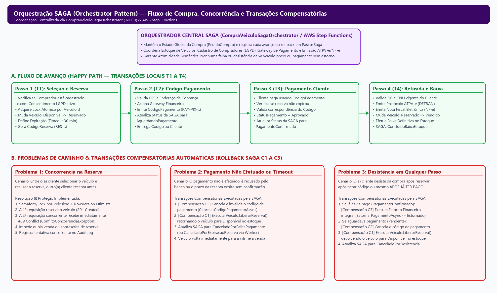
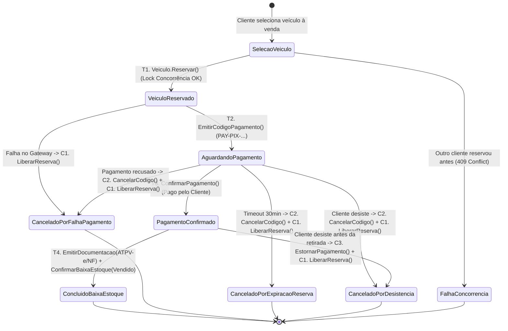

# 3. Relatório de Orquestração SAGA e Consistência Transacional

**Projeto:** Plataforma de Revenda de Veículos Automotores — FIAP Pós-Tech SOAT (Fase 5)  
**Padrão Adotado:** **SAGA Orquestrada (*Orchestration-Based Saga*)**

---

## 3.1. O Problema das Transações Distribuídas no Processo de Compra de Veículos

O processo de compra de um veículo automotor na plataforma abrange múltiplos domínios e integrações externas com tempos de resposta heterogêneos:
1. **Seleção do veículo e validação cadastral/LGPD do comprador** (Domínio de Clientes);
2. **Reserva exclusiva do automóvel no estoque** (Domínio de Estoque/Veículos — sujeito a disputa concorrente entre clientes);
3. **Emissão do código de pagamento** (Domínio de Pagamentos / Gateway Financeiro PIX ou Boleto);
4. **Liquidação financeira pelo comprador** (Passo assíncrono sujeito a não pagamento, recusa bancária ou expiração de prazo);
5. **Emissão da documentação legal (ATPV-e DETRAN + NF-e SEFAZ), retirada do veículo e baixa definitiva no estoque** (Domínio de Documentação e Estoque).

Além do caminho feliz, o negócio exige tratamento rigoroso para **três cenários críticos de falha/exceção**:
- **Problema 1 (Concorrência na Reserva):** Entre o cliente selecionar o veículo e confirmar a reserva, outro(a) cliente reserva o veículo antes;
- **Problema 2 (Pagamento Não Efetuado):** O pagamento é recusado pela instituição financeira ou o prazo de reserva expira sem pagamento;
- **Problema 3 (Desistência do Cliente em Qualquer Passo):** O(a) cliente desiste da compra após reservar, após receber o código de pagamento, ou até mesmo **após já ter efetuado o pagamento** (antes da retirada física do veículo).

Utilizar transações distribuídas tradicionais (*Two-Phase Commit — 2PC / XA*) é inviável neste cenário porque manteria *locks* pessimistas de banco de dados abertos durante minutos ou horas enquanto se aguarda o pagamento do cliente, degradando completamente a disponibilidade da plataforma. Portanto, o padrão **SAGA** é indispensável.

---

## 3.2. Comparativo: SAGA Coreografada vs. SAGA Orquestrada

Antes de definir a solução, foram avaliadas as duas abordagens clássicas de implementação do padrão SAGA:

| Critério Arquitetural | SAGA Coreografada (*Choreography*) | SAGA Orquestrada (*Orchestration*) — **ESCOLHIDA** |
| :--- | :--- | :--- |
| **Mecanismo de Coordenação** | Descentralizado: cada serviço escuta eventos no broker e decide autonomamente qual próximo evento publicar. | Centralizado: um **Orquestrador SAGA** (`CompraVeiculoSagaOrchestrator` / **AWS Step Functions**) comanda explicitamente cada passo e gerencia a máquina de estados. |
| **Visibilidade do Estado da Compra** | Baixa: o estado atual do pedido fica fragmentado entre vários serviços e filas. | **Total:** o agregado `PedidoCompra` e o histórico `PassosSaga` (e o painel do Step Functions) exibem exatamente em qual passo a compra está ou qual compensação foi acionada. |
| **Tratamento de Desistência em Qualquer Passo** | Complexo e propenso a condições de corrida (exige múltiplos eventos cruzados de cancelamento dependendo de quais passos já rodaram). | **Determinístico e Seguro:** o Orquestrador avalia o estado exato da máquina de estados e executa apenas as transações compensatórias necessárias na ordem inversa (*Backward Recovery*). |
| **Controle de Timeout de Reserva** | Difícil de coordenar sem criar acoplamento temporal entre serviços de estoque e pagamento. | **Nativo:** o Orquestrador controla `DataExpiracaoReserva` (via `waitForTaskToken` no Step Functions e `ReservaExpiracaoBackgroundService`) e dispara a compensação automaticamente. |
| **Risco de Dependência Cíclica** | Alto conforme o número de passos e compensações cresce (4 passos de avanço + 4 fluxos de compensação). | **Zero:** os domínios de Estoque, Clientes, Pagamento e Documentação não precisam conhecer uns aos outros; todos respondem ao Orquestrador. |

---

## 3.3. Decisão Arquitetural e Justificativa: Por que SAGA Orquestrada?

A arquitetura adota a **SAGA Orquestrada (*Orchestration-Based Saga*)**, implementada no código através da classe `CompraVeiculoSagaOrchestrator` (na camada `Application`) em conjunto com a máquina de estados rica do agregado `PedidoCompra` (na camada `Domain`) e especificada na nuvem via **AWS Step Functions**.

### Justificativas Principais:
1. **Fluxo de Negócio com Múltiplos Pontos de Decisão e Compensação Condicional:**
   - Quando o(a) cliente desiste da compra, a ação compensatória depende diretamente do passo em que a SAGA se encontra:
     - Se desistiu no passo `AguardandoPagamento`: basta cancelar o código de pagamento e liberar a reserva do veículo no estoque.
     - Se desistiu no passo `PagamentoConfirmado` (antes da retirada): o Orquestrador **precisa obrigatoriamente comandar o Estorno Financeiro (`EstornarPagamentoAsync`)** antes de liberar o veículo de volta para `Disponivel` no estoque.
   - Um orquestrador central toma essa decisão de forma atômica, sem risco de liberar o veículo sem estornar o dinheiro (ou vice-versa).
2. **Prevenção de *Race Conditions* entre Pagamento Tardio, Desistência e Expiração de Reserva:**
   - Como todas as transições de estado passam pelo Orquestrador (`StatusPedidoCompra`), é impossível que uma reserva expirada seja paga simultaneamente à liberação do veículo para outro comprador.
3. **Auditoria Completa e Observabilidade de Ponta a Ponta:**
   - Cada passo executado (`ExecucaoAvanco`) ou desfeito (`CompensacaoRollback`) é gravado na coleção `PassosSaga` (`SagaStepLog`) e no `AuditLog`, permitindo rastrear cada milissegundo da jornada do cliente.

---

## 3.4. Máquina de Estados e Matriz de Transações (Avanço vs. Compensação)

### Tabela de Transações Locais ($T_i$) e Transações Compensatórias ($C_i$):

| Passo | Serviço / Domínio | Transação Local de Avanço ($T_i$) | Transação Compensatória de Rollback ($C_i$) |
| :---: | :--- | :--- | :--- |
| **Passo 1** | **Clientes & Estoque (`Veiculo`)** | **$T_1$ — Validar Comprador & Reservar Veículo:** Verifica cadastro ativo, consentimento LGPD e altera status do veículo de `Disponivel` para `Reservado` (atualizando `RowVersion`). | **$C_1$ — Liberar Reserva no Estoque (`Veiculo.LiberarReserva`):** Retorna o status do veículo para `Disponivel`, limpa `DataVenda`, rotaciona `RowVersion` e reexibe o veículo na listagem ordenada por preço. |
| **Passo 2** | **Pagamentos (`IPagamentoGatewayService`)** | **$T_2$ — Emitir Código de Pagamento:** Gera cobrança vinculada ao CPF do comprador (`PAY-PIX-...`) e atualiza SAGA para `AguardandoPagamento`. | **$C_2$ — Cancelar Código de Pagamento (`CancelarCodigoPagamentoAsync`):** Invalida o código PIX/Boleto no gateway para impedir pagamentos tardios e aciona $C_1$. |
| **Passo 3** | **Pagamentos (`PedidoCompra`)** | **$T_3$ — Confirmar Pagamento:** Valida liquidação do código de pagamento e avança estado da SAGA para `PagamentoConfirmado`. | **$C_3$ — Estornar Pagamento (`EstornarPagamentoAsync`):** Caso o cliente desista após pagar (ou ocorra erro impeditivo na retirada), executa devolução integral do valor pago ao comprador e aciona $C_1$. |
| **Passo 4** | **Documentação & Estoque (`IDocumentacaoVeicularService`)** | **$T_4$ — Emitir Documentação, Retirada e Baixa no Estoque:** Valida CNH vigente e RG do comprador, emite protocolo `ATPV-e` (DETRAN) e `NF-e`, altera veículo para `Vendido` e conclui a SAGA (`ConcluidoBaixaEstoque`). | *Ponto de Commit Semântico (Pivot Transaction concluída na entrega física do bem).* |

---

## 3.5. Resolução Detalhada dos Problemas de Caminho Exigidos no Caso de Uso

### Cenário A — Outro(a) cliente reserva o veículo antes (Concorrência)
1. **O que ocorre:** O Cliente A e o Cliente B visualizam o mesmo veículo na vitrine (`GET /api/v1/veiculos/a-venda`) e clicam em reservar quase ao mesmo tempo (`POST /api/v1/compras/reservar`).
2. **Como a SAGA resolve:**
   - O `CompraVeiculoSagaOrchestrator` aplica controle de concorrência em duas camadas: semáforo assíncrono por `VeiculoId` (em nuvem, lock condicional no DynamoDB) + validação de estado `Veiculo.Reservar()` combinada ao token otimista `RowVersion` no banco relacional.
   - O primeiro cliente reserva com sucesso (`201 Created`) e recebe seu `CodigoPagamento`.
   - O segundo cliente recebe imediatamente `409 Conflict` (`ConflitoConcorrenciaException`: *"Este veículo acabou de ser reservado por outro(a) cliente e não está disponível no momento"*), e o evento é registrado no `AuditLog`.

### Cenário B — O pagamento não é efetuado ou expira
1. **O que ocorre:** O cliente reservou o veículo e recebeu o `CodigoPagamento`, mas o pagamento é recusado pelo banco (`PagamentoEfetuado = false`) ou o prazo de 30 minutos expira.
2. **Como a SAGA resolve:**
   - O Orquestrador SAGA intercepta a recusa ou o evento de expiração (`ReservaExpiracaoBackgroundService`).
   - Executa a compensação $C_2$ (`CancelarCodigoPagamentoAsync`) invalidando o código emitido.
   - Executa a compensação $C_1$ (`veiculo.LiberarReserva()`), retornando imediatamente o veículo ao status `Disponivel` na vitrine de veículos à venda.
   - Marca a SAGA como `CanceladoPorFalhaPagamento` (ou `CanceladoPorExpiracaoReserva`) e registra os passos de rollback em `HistoricoPassosSaga`.

### Cenário C — O(a) cliente desiste da compra em qualquer um dos passos
1. **O que ocorre:** O cliente aciona `POST /api/v1/compras/{pedidoId}/desistir` informando o motivo da desistência:
   - **Subcaso C.1 (Desistência antes de pagar):** O Orquestrador executa $C_2$ (cancela o código de pagamento pendente) + $C_1$ (libera o veículo para `Disponivel`) e encerra a SAGA como `CanceladoPorDesistencia`.
   - **Subcaso C.2 (Desistência após já ter pago, antes da retirada):** O Orquestrador identifica que `StatusPagamento == Aprovado`, executa a compensação financeira $C_3$ (`EstornarPagamentoAsync`, mudando o status do pagamento para `Estornado`) e, em seguida, executa $C_1$ (`veiculo.LiberarReserva()`), devolvendo o automóvel ao estoque como `Disponivel` com total integridade financeira e contábil.
